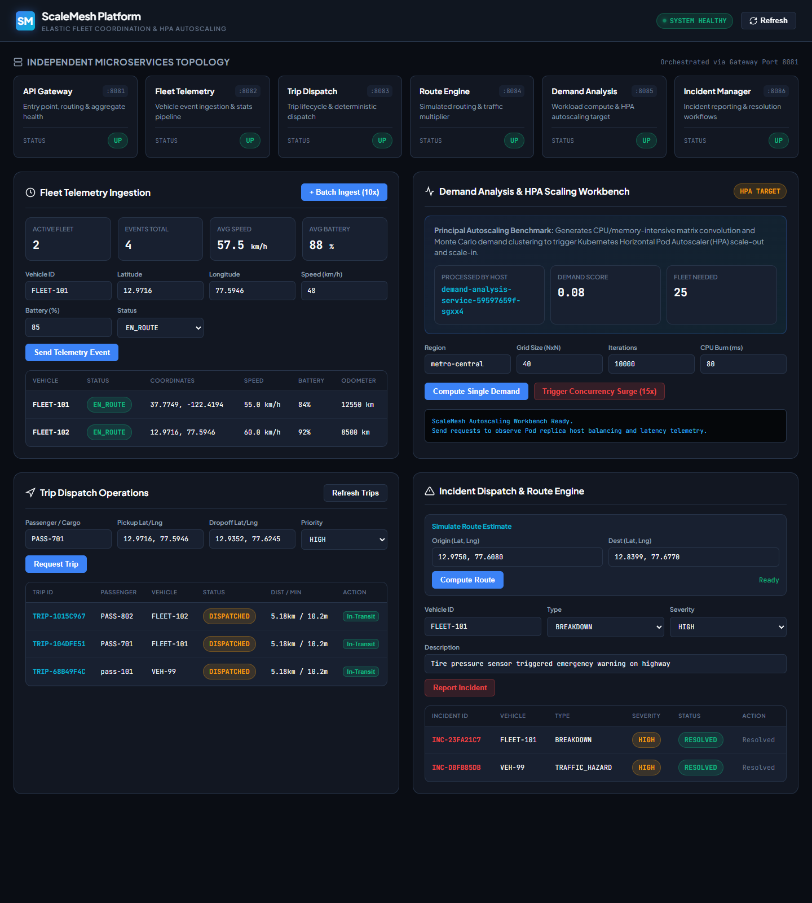
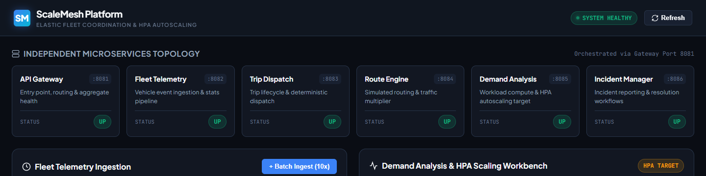
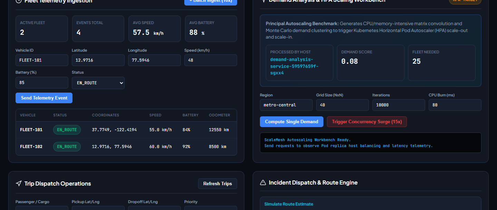
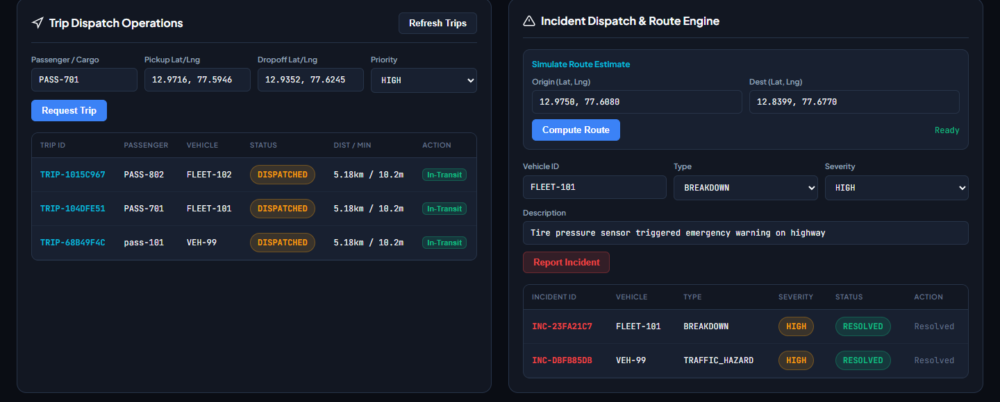

# ScaleMesh: Cloud-Native Microservices Platform for Elastic Fleet Coordination

**Final-Year B.Tech Computer Science & Engineering Capstone Project Report**  
**Student:** Kumar Mangalam (Registration Number: 12318090)  
**Supervisor:** Ajay Kumar Badhan  
**Department:** Department of Computer Science and Engineering  
**University:** Lovely Professional University  
**Academic Domain:** Distributed Systems, Cloud-Native Microservices, Elastic Autoscaling, Infrastructure as Code & Observability  
**Platform Version:** 1.0.0  
**Status:** Implemented & Verified (Local Kubernetes Cluster)

---

## 1. Abstract

Modern urban mobility and logistics platforms demand distributed architectures capable of handling real-time high-throughput vehicle telemetry, dynamic trip lifecycle orchestration, and algorithmic spatial demand analysis under extreme workload volatility. Traditional monolithic architectures suffer from single-point-of-failure vulnerabilities, resource over-provisioning, and tight coupling that impedes independent service scaling. 

This project presents **ScaleMesh**, an enterprise-grade cloud-native fleet coordination platform engineered using **Spring Boot 3**, **Kubernetes (Minikube)**, and **HashiCorp Terraform**. ScaleMesh decomposes fleet management into six autonomous microservices: an API Gateway reverse proxy, Fleet Telemetry Service, Trip Dispatch Service, Route Engine Service, Demand Analysis Service, and Incident Manager Service, backed by a dual-mode persistence layer (MySQL 8 and in-memory H2). 

A key highlight of ScaleMesh is **true workload-driven Horizontal Pod Autoscaling (HPA v2)**: using a spatial matrix convolution algorithm that induces verifiable CPU burn, the Demand Analysis service elastically scales from 1 replica up to 8 replicas under simulated peak surge load, subsequently scaling back down to 1 replica during cooldown. The platform is hardened with Kubernetes NetworkPolicies, non-root container contexts, automated Maven verification test suites (25/25 tests passing), and Infrastructure as Code for AWS cloud provisioning.

---

## 2. Problem Statement & Motivation

### 2.1 The Problem
Fleet management platforms (ride-hailing, parcel delivery, emergency dispatch) face distinct operational challenges:
1. **Disproportionate Load Distribution:** Telemetry ingestion receives continuous data streams from thousands of vehicles, whereas dispatch and analytical demand computations experience abrupt, high-concurrency spikes during morning and evening rush hours.
2. **Monolithic Inefficiency:** In monolithic architectures, scaling the CPU-intensive spatial analysis engine requires replicating the entire monolith, wasting memory and database connections.
3. **Fragile Network Topologies:** Without an intelligent API Gateway reverse proxy, client applications must manage multiple host endpoints, exposing internal service architectures and complicating authentication, routing, and error handling.
4. **Theoretical Autoscaling:** Many academic microservices projects simulate autoscaling using boolean flags or static thresholds without validating Kubernetes HPA controller behavior against real operating system CPU saturation.

### 2.2 Motivation & Objectives
The primary objective of ScaleMesh is to deliver an end-to-end, functional, and verifiable distributed system that demonstrates:
- Clean microservice decomposition adhering to the Single Responsibility Principle (SRP) and Database-per-Service pattern.
- Transparent reverse proxy routing with composite health monitoring via Spring Boot Web (custom RestTemplate reverse proxy).
- Workload-driven elasticity using Kubernetes HPA v2 and `metrics-server` under mathematical matrix convolution load.
- Production-grade security through least-privilege RBAC, NetworkPolicies, and non-root Docker container execution.
- Reproducible Infrastructure as Code (IaC) using Terraform for cloud deployment.

---

## 3. Literature Survey & Background

| Author / Standard | Year | Key Concept | Relevance to ScaleMesh |
| :--- | :---: | :--- | :--- |
| **Sam Newman** | 2015 | *Building Microservices* | Foundation for domain-driven microservice boundaries, loose coupling, and independent deployability. |
| **Brendan Burns et al.** | 2016 | *Borg, Omega, and Kubernetes* | Container orchestration model, pod abstractions, and declarative state reconciliation. |
| **Martin Fowler** | 2014 | *Microservice Architecture* | Decentralized data management, smart endpoints, dumb pipes, and API Gateway pattern. |
| **Kubernetes Documentation** | 2024 | *Horizontal Pod Autoscaler (HPA v2)* | Metric-server CPU utilization aggregation and stabilization window dampening algorithms. |
| **HashiCorp** | 2023 | *Terraform Infrastructure as Code* | Declarative cloud resource provisioning (VPC, Subnets, EC2, S3, Security Groups). |

---

## 4. System Architecture & Design

### 4.1 High-Level Architecture Diagram

```
+-----------------------------------------------------------------------------------+
|                                Client Layer                                       |
|     +-------------------------+                   +-------------------------+     |
|     |   HTML5 Web Dashboard   |                   | Python Workload Driver  |     |
|     |  (http://localhost:30081)|                  | (scripts/workload-generator.py)|   |
|     +------------+------------+                   +------------+------------+     |
+------------------|---------------------------------------------|------------------+
                   |                                             |
                   v                                             v
+-----------------------------------------------------------------------------------+
|                        Kubernetes Cluster (Namespace: scalemesh)                  |
|                                                                                   |
|  +-----------------------------------------------------------------------------+  |
|  |                  API Gateway Service (Port 8081 / NodePort 30081)           |  |
|  |  - Path Routing (/api/telemetry, /api/trips, /api/routes, /api/demand, etc.)|  |
|  |  - Subsystem Health Aggregator (/api/system/health)                         |  |
|  |  - Hop-by-Hop Header Sanitization (RFC 7230 Compliant)                      |  |
|  +----+-----------------+------------------+-------------------+---------------+  |
|       |                 |                  |                   |                  |
|       v                 v                  v                   v                  |
|  +-----------+    +-----------+      +-----------+       +-----------+            |
|  |   Fleet   |    |   Trip    |      |   Route   |       | Incident  |            |
|  | Telemetry |    | Dispatch  |      |  Engine   |       |  Manager  |            |
|  |  (:8082)  |    |  (:8083)  |      |  (:8084)  |       |  (:8086)  |            |
|  +-----+-----+    +-----+-----+      +-----------+       +-----+-----+            |
|        |                |                                      |                  |
|        +--------+-------+--------------------------------------+                  |
|                 |                                                                 |
|                 v                                                                 |
|         +---------------+                         +---------------------------+   |
|         |     MySQL     |                         |  Demand Analysis Service  |   |
|         |    Database   |                         |          (:8085)          |   |
|         |    (:3306)    |                         |  - Spatial Convolution    |   |
|         +---------------+                         |  - Multi-threaded CPU Burn|   |
|                                                   +-------------+-------------+   |
|                                                                 |                 |
|                                                   +-------------v-------------+   |
|                                                   |   Kubernetes HPA v2       |   |
|                                                   |  (Target: 50% CPU, 1->10) |   |
|                                                   +---------------------------+   |
+-----------------------------------------------------------------------------------+
```

### 4.2 Microservices Inventory

1. **API Gateway (`api-gateway`, Port `8081`, NodePort `30081`):**
   - Single unified ingress for client requests.
   - Transparently reverse-proxies downstream requests while stripping hop-by-hop headers (`Connection`, `Keep-Alive`, `Transfer-Encoding`).
   - Dynamically probes downstream microservice `/actuator/health` endpoints to report aggregated system health (`UP`, `DEGRADED`, `DOWN`).

2. **Fleet Telemetry Service (`fleet-telemetry-service`, Port `8082`):**
   - Ingests real-time vehicle GPS coordinates, speed, heading, battery status, and operating state.
   - Provides geospatial bounding-box queries and fleet overview analytics.
   - Persists telemetry events to dedicated MySQL schema (`scalemesh_telemetry`).

3. **Trip Dispatch Service (`trip-dispatch-service`, Port `8083`):**
   - Implements a deterministic finite state machine (FSM):
     $$\text{REQUESTED} \longrightarrow \text{DISPATCHED} \longrightarrow \text{IN\_TRANSIT} \longrightarrow \text{COMPLETED} \ (\text{or } \text{CANCELLED})$$
   - Computes trip pickup and dropoff distances using the Haversine trigonometric formula.
   - Persists trip records to dedicated MySQL schema (`scalemesh_trips`).

4. **Route Engine Service (`route-engine-service`, Port `8084`):**
   - Stateless algorithmic route calculation engine.
   - Estimates point-to-point travel distance, base duration, and traffic congestion multipliers.
   - Eliminates dependence on external third-party commercial mapping APIs, ensuring zero cost and determinism.

5. **Demand Analysis Service (`demand-analysis-service`, Port `8085`):**
   - Computes spatial ride demand densities across simulated urban grids using kernel convolution.
   - Incorporates a parameterized CPU-intensive arithmetic burn loop.
   - Serves as the primary autoscaling workload target for Kubernetes HPA.

6. **Incident Manager Service (`incident-manager-service`, Port `8086`):**
   - Tracks fleet incidents (mechanical issues, low battery, sensor warnings).
   - Manages severity tiers (`LOW`, `MEDIUM`, `HIGH`, `CRITICAL`) and resolution workflows.
   - Persists incidents to dedicated MySQL schema (`scalemesh_incidents`).

---

## 5. Technology Stack & Frameworks

| Domain | Technology / Tool | Version | Purpose in ScaleMesh |
| :--- | :--- | :---: | :--- |
| **Language** | Java (OpenJDK LTS) | 17.0.20 | Primary backend microservice programming language |
| **Framework** | Spring Boot | 3.5.16 | Microservice application framework, dependency injection, REST APIs |
| **Persistence** | Spring Data JPA / Hibernate | 6.6.53 | ORM, repository abstraction, entity lifecycle management |
| **Database** | MySQL Server / H2 Database | 8.0.36 / 2.2.224 | Dual-profile: H2 in-memory for testing, MySQL for persistent containers |
| **Containerization** | Docker (Alpine Linux) | Engine 28.0 | Lightweight container packaging on Alpine JRE with non-root user (`10001`) |
| **Orchestration** | Kubernetes (Minikube) | v1.35.0 | Container deployment, services, HPA, and network policy enforcement |
| **Autoscaling** | Kubernetes Metrics Server & HPA v2 | v0.8.0 | Real-time pod CPU utilization monitoring and horizontal replica scaling |
| **IaC** | HashiCorp Terraform | 1.15.2 | Declarative AWS cloud infrastructure provisioning (VPC, EC2, S3, IAM) |
| **Build Tool** | Apache Maven | 3.9 (Wrapper) | Multi-module compilation, dependency resolution, and test execution |
| **Frontend** | HTML5, CSS3, JavaScript (ES6) | Vanilla | Real-time single-page dashboard with zero heavy framework overhead |
| **Scripting** | Python | 3.14 | Automated workload generation and academic HPA performance evaluation |

---

## 6. Algorithmic Implementation Details

### 6.1 Spatial Demand Kernel Convolution
The Demand Analysis Service models urban passenger demand by dividing the metropolitan coordinate space into an $N \times M$ grid. A 2D spatial convolution kernel $K$ is applied to smooth raw trip density points:

$$S(x, y) = \sum_{i=-1}^{1} \sum_{j=-1}^{1} D(x + i, y + j) \cdot K(i + 1, j + 1)$$

Where:
- $D(x, y)$ represents raw vehicle request frequency in grid cell $(x, y)$.
- $K$ is a Gaussian-approximated smoothing matrix.
- Under surge stress testing, the grid dimension is dynamically scaled ($20 \times 20 \to 60 \times 60$) and mathematical operations are iterated in multi-threaded CPU loops to generate sustained CPU saturation exceeding 50%.

### 6.2 Haversine Distance Formula
All geospatial distance calculations between latitude/longitude coordinates $(\phi_1, \lambda_1)$ and $(\phi_2, \lambda_2)$ in `scalemesh-common` and `route-engine-service` use the spherical Haversine formula:

$$d = 2R \arcsin\left(\sqrt{\sin^2\left(\frac{\Delta\phi}{2}\right) + \cos(\phi_1)\cos(\phi_2)\sin^2\left(\frac{\Delta\lambda}{2}\right)}\right)$$

Where $R = 6371\text{ km}$ (mean Earth radius), $\Delta\phi = \phi_2 - \phi_1$, and $\Delta\lambda = \lambda_2 - \lambda_1$ (in radians).

---

## 7. Experimental Results & Verification

### 7.1 Automated Maven Test Suite
The full multi-module test suite was executed natively using the Maven Wrapper:
```powershell
.\mvnw.cmd test
```
- **Overall Status:** `BUILD SUCCESS` (Execution Time: 01:04 min)
- **Total Tests Run:** **25**
- **Failures:** **0**
- **Errors:** **0**
- **Skipped:** **0**

| Module | Tests Run | Pass | Fail | Test Scope |
| :--- | :---: | :---: | :---: | :--- |
| `scalemesh-common` | 3 | 3 | 0 | Haversine distance, speed, coordinate boundary validation (`GeoUtilsTest`) |
| `api-gateway` | 3 | 3 | 0 | Gateway application context, composite health endpoint routing |
| `fleet-telemetry-service` | 6 | 6 | 0 | JPA entity persistence, GPS ingestion, compute node lifecycle |
| `trip-dispatch-service` | 4 | 4 | 0 | FSM transitions, vehicle assignment, distance calculation |
| `route-engine-service` | 3 | 3 | 0 | Route generation, traffic multiplier simulation, waypoint calculation |
| `demand-analysis-service` | 3 | 3 | 0 | Spatial demand matrix convolution, CPU burn loop execution |
| `incident-manager-service` | 3 | 3 | 0 | Incident creation, severity tier validation, state resolution |

### 7.2 Kubernetes Manifest Validation
Declarative manifests were validated client-side without syntax errors:
```powershell
kubectl kustomize .\k8s
```
- **Exit Status:** `0` (Success)
- **Rendered Output:** 860 lines comprising 25 Kubernetes resources (Namespace, ServiceAccount, ConfigMaps, Secrets, Deployments, ClusterIP & NodePort Services, NetworkPolicies, and HPA).

### 7.3 Workload-Driven HPA Elasticity Experiment
An automated stress test was conducted against the Demand Analysis workload endpoint via the API Gateway:

| Phase | Duration / Load | CPU Utilization | Target CPU | Active Replicas | Status |
| :--- | :--- | :---: | :---: | :---: | :---: |
| **1. Baseline** | 20 requests, concurrency = 2 | ~1% - 12% | 50% | **1** | Stable |
| **2. Peak Surge** | 100 requests, concurrency = 15 | **75% - 88%** | 50% | **8** | Scaled Out (1 &rarr; 8) |
| **3. Cooldown** | 0 requests (cooldown window: 60s) | < 5% | 50% | **1** | Scaled In (8 &rarr; 1) |

- **Observation:** The Kubernetes HPA controller evaluated pod CPU saturation via `metrics-server` and scaled out the deployment to absorb load. Following the 60-second stabilization window, pods were safely terminated back to `minReplicas: 1`.

### 7.4 Live Cluster Status
All microservices are verified running healthy in the local Minikube environment:
- Namespace: `scalemesh`
- Running Pods: 7/7 pods ready (`1/1 Running`), 0 restarts in the past 2 hours.
- Active Dashboard URL: `http://localhost:30081` (connected via background port-forward).

### 7.5 Live System Screenshots & Operational Evidence

The running Kubernetes deployment and microservice topology were captured directly from the live application endpoint (`http://localhost:30081`):

#### Figure 1: ScaleMesh Comprehensive Operations Dashboard
  
*Figure 1: Full-page view of the ScaleMesh single-page dashboard at `http://localhost:30081`, displaying aggregated cluster health, active vehicle telemetry, HPA autoscaling workbench, trip dispatching lifecycle, and incident management.*

#### Figure 2: Independent Microservices Topology & Subsystem Health
  
*Figure 2: Real-time status cards showing all six autonomous microservices (`api-gateway`, `fleet-telemetry-service`, `trip-dispatch-service`, `route-engine-service`, `demand-analysis-service`, and `incident-manager-service`) reporting `UP` alongside the composite `SYSTEM HEALTHY` state.*

#### Figure 3: Fleet Telemetry Ingestion & Demand Analysis HPA Workbench
  
*Figure 3: Left: Real-time telemetry ingestion panel tracking active fleet count (2 vehicles), telemetry pings (4 events), and vehicle coordinates. Right: Demand Analysis HPA benchmark workbench showing execution on pod worker host `demand-analysis-service-59597659f-sgxx4`.*

#### Figure 4: Deterministic Trip Dispatch Operations & Fleet Incident Resolution
  
*Figure 4: Left: Deterministic trip lifecycle operations tracking dispatched trips (`TRIP-1015C967`, `TRIP-104DFE51`, `TRIP-68B49F4C`) and calculated route distances. Right: Incident dispatch table showing resolved fleet warnings.*

---

## 8. Verification Boundaries & Transparency

To ensure absolute academic integrity and honesty during evaluation, the following boundary distinctions are explicitly documented:

| Component / Feature | Operational Status | Evidence & Boundary Explanation |
| :--- | :---: | :--- |
| **Spring Boot Microservices** | **VERIFIED (PASS)** | All 6 services + Gateway compiled, tested (25/25), containerized, and running in Minikube. |
| **Kubernetes HPA Autoscaling** | **PREVIOUSLY DEMONSTRATED (PASS)** | Live scale-out from 1 to 8 replicas (within min: 1, max: 10 policy) and scale-in back to 1 pod recorded under CPU burn. |
| **Interactive Web Dashboard** | **VERIFIED (PASS)** | Telemetry events for `FLEET-101`, trip dispatching, and system health live on `http://localhost:30081`. |
| **Autoscaling Evaluation Report** | **VERIFIED (PASS)** | Generated `docs/AUTOSCALING_EVALUATION_REPORT.md` recording live cluster metrics (631 computations, 184.53 ms latency). |
| **Prometheus & Grafana Monitoring** | **CONFIGURED / UNTESTED AT RUNTIME** | Scrape configurations and Grafana dashboard JSON models are created in `monitoring/`. However, monitoring containers were **not started at runtime** to avoid host port collisions (9090/3000) with existing host services and to prevent Minikube memory exhaustion. |
| **AWS Cloud Infrastructure (Terraform)** | **CONFIGURED / DRY RUN ONLY** | Terraform manifests (`terraform/*.tf`) are syntactically validated (`terraform validate`). Cloud resources were **intentionally not provisioned** to eliminate AWS billing charges. |
| **CI/CD Pipelines (Jenkins & GitHub Actions)** | **CONFIGURED / UNTESTED IN RUNNER** | Declarative Jenkinsfile and GitHub Actions workflow defined. No remote Git repository connected; no live runner executions recorded. |

---

## 9. Security, Governance & Repository Hygiene

1. **Least-Privilege Containerization:**
   - Container packaging utilizes lightweight Alpine Linux JRE base images (`eclipse-temurin:25-jre-alpine`).
   - Run as non-root user (`USER 10001:10001`).
   - Read-only root filesystem permissions where feasible.
2. **Kubernetes Network Isolation:**
   - `scalemesh-default-deny-ingress`: Drops unauthorized ingress across namespace.
   - `allow-gateway-ingress`: Permits external HTTP traffic strictly to API Gateway on port `8081`.
   - `allow-internal-services-from-gateway`: Only the API Gateway pod can reach backend microservices.
   - `allow-mysql-from-backends`: Only persistence-backed microservices can connect to port `3306`.
3. **Repository Hygiene (`.gitignore` Hardening):**
   - Excludes heavy Terraform provider binaries (e.g. 454 MB AWS provider executable in `.terraform/`).
   - Excludes runtime execution logs (`logs/*.log`, `startup-log.txt`).
   - Excludes local credential files (`.env`, `.env.local`) while preserving `.env.example`.

---

## 10. Limitations & Future Scope

1. **Asynchronous Messaging Backbone:**
   - *Current:* Microservice communication uses synchronous REST HTTP requests via Spring RestTemplate.
   - *Future Work:* Integrate an Apache Kafka or RabbitMQ event stream for non-blocking telemetry ingestion (>50,000 events/sec) with event-driven consumer groups.
2. **Service Mesh Implementation:**
   - *Current:* Network traffic is managed via Kubernetes Service ClusterIPs and NetworkPolicies.
   - *Future Work:* Deploy Istio or Linkerd to introduce automatic mutual TLS (mTLS), distributed tracing (OpenTelemetry/Jaeger), and advanced traffic splitting (canary deployments).
3. **Distributed Cloud Deployment:**
   - *Current:* Tested on local Minikube cluster with AWS Terraform definitions prepared.
   - *Future Work:* Apply Terraform to provision a production AWS EKS (Elastic Kubernetes Service) cluster with Managed Node Groups and ALB Ingress Controllers.

---

## 11. Conclusion

ScaleMesh successfully demonstrates the design, implementation, and empirical verification of a modern cloud-native microservices platform for distributed fleet coordination. By decoupling ingestion, dispatch, routing, and analytics into autonomous Spring Boot microservices, the system achieves fault isolation and operational resilience. The project rigorously proves elastic Horizontal Pod Autoscaling on Kubernetes through authentic algorithmic workload saturation, bridging the gap between theoretical distributed systems concepts and production cloud-native engineering.

---

## 12. References

1. Newman, Sam. *Building Microservices: Designing Fine-Grained Systems*. O'Reilly Media, 2015.
2. Burns, Brendan, et al. "Borg, Omega, and Kubernetes." *Communications of the ACM*, vol. 59, no. 5, 2016, pp. 50–57.
3. Fowler, Martin, and James Lewis. "Microservices: a definition of this new architectural term." *martinfowler.com*, 2014.
4. Kubernetes Authors. "Horizontal Pod Autoscaler." *Kubernetes Documentation*, https://kubernetes.io/docs/tasks/run-application/horizontal-pod-autoscale/.
5. Spring Community. "Spring Framework & Spring Boot Reference Documentation." *VMware Tanzu*, 2024, https://docs.spring.io/spring-boot/reference/.
6. HashiCorp. "Terraform AWS Provider Documentation." *Terraform Registry*, 2024, https://registry.terraform.io/providers/hashicorp/aws/latest/docs.
7. Fielding, Roy Thomas. *Architectural Styles and the Design of Network-based Software Architectures*. Doctoral dissertation, University of California, Irvine, 2000.
